# Auditoría de cierre: teckware.cl

Medición "antes" del 2026-10-31, sobre producción (commit `8ce1b62`). Es el punto de comparación para el
cierre. **En este bloque no se cambió nada del sitio:** las fallas se informan, pero aún no se corrigen.

## Resumen

El sitio está sano para quien lo visita: sin enlaces rotos, sin scroll horizontal, sin errores de consola,
sin imágenes rotas y con el chatbot correcto en precios y horario. Los problemas de fondo son cuatro:

1. **`/agendar` y su API aceptan datos inválidos**, y si el guardado falla nadie se entera.
2. **`/builds` y la landing medida superan el objetivo de LCP en móvil:** 3,0 y 3,3 s contra 2,5 s.
3. **Las fotos de clientes quedan en un bucket público**, y la subida acepta archivos que no son imágenes.
4. **El teléfono no se puede tocar en ninguna página:** no hay enlaces `tel:` y el evento `click_telefono` nunca se dispara.

| Punto | Resultado | Estado |
|---|---|---|
| 1. Enlaces | 28 internos responden 200; WhatsApp e Instagram llegan a 200 | OK |
| 2. Formularios | `/agendar` 24/28 · `/solicitar` 18/20 · API 4/9 · PC Gamer aún no existe | Falla |
| 2c. `/admin` | 7/7 | OK |
| 3. Chatbot | 16/16: precios, horario, zona y plazo coinciden con `lib/constants.ts` | OK |
| 4. Móvil y escritorio | 29 rutas × 2 tamaños: sin scroll horizontal ni errores de consola | OK |
| 5. Accesibilidad | axe sin fallas graves en páginas públicas; 6/11 en teclado y foco | Falla |
| 6. Rendimiento | CLS 0; LCP bien en 3 de 5 páginas; JS sobre el presupuesto | Falla |
| 7. SEO | Títulos, descripciones y canonical correctos; falta `og:url` | Mejora |
| 8. Imágenes | Ninguna rota; ninguna servida pesa más de 200 KB (máx. 127 KB) | OK |

## Fallas y mejoras, por impacto

| # | Estado | Hallazgo | Evidencia | Dónde |
|---|---|---|---|---|
| 1 | Falla | `/agendar` deja continuar con nombre "x" y teléfono "abc" | Se puede avanzar al resumen; `/solicitar` sí los rechaza | `app/agendar/page.tsx:131` |
| 2 | Falla | La API de solicitudes no valida los datos | Guarda un nombre de 100.000 caracteres, un teléfono inválido y una URL de foto de otro sitio | `app/api/solicitudes/route.ts:22` |
| 3 | Falla | Si el guardado falla, no hay aviso ni reintento | Con un error 500 simulado no aparece nada, y el flag `registrada` impide reintentar | `app/agendar/page.tsx:182` |
| 4 | Falla | Fotos de clientes públicas | El bucket se crea con `public: true`, y la URL pública va en el mensaje de WhatsApp. Se corrige en el Bloque C | `app/api/upload/route.ts:25` |
| 5 | Falla | La subida acepta archivos que no son imágenes | Un texto declarado como PNG responde 200: solo se revisa el tipo declarado | `app/api/upload/route.ts:44` |
| 6 | Falla | LCP móvil sobre 2,5 s | `/builds` 3,04 s y `/mantencion-pc-gamer` 3,26 s. **Causa sin confirmar:** las imágenes pesan poco (6 y 20 KB) y el FCP es normal. Las otras landings usan la misma plantilla, pero no se midieron | `app/builds/page.tsx:74`, `components/landing/ServiceLanding.tsx:67` |
| 7 | Falla | JS inicial sobre el presupuesto de 150 KB | 186–193 KB gzip, más unos 176 KB de `gtag.js` (estimado comprimiendo el archivo) | Todo el sitio |
| 8 | Falla | Foco de teclado perdido | En el wizard, el foco cae a `body` al cambiar de paso, sin anuncio para lector de pantalla. Al cerrar el chat con Esc pasa lo mismo | `app/agendar/page.tsx`, `components/layout/ChatWidget.tsx:49` |
| 9 | Falla | Errores de `/solicitar` no anunciados | Sin `aria-invalid` ni `role="alert"` | `app/solicitar/page.tsx:98` |
| 10 | Falla | Login de `/admin` con problemas de accesibilidad | Botón de ver contraseña sin nombre (axe crítico) y de 16 px; etiqueta sin vincular | `app/admin/page.tsx:185`, `:194` |
| 11 | Falla | `/builds` tiene textos no verificables | "Disponible", "Más pedido", "Bajo pedido", "Cotizamos gratis" y precios fijos. Se corrige en el Bloque C | `app/builds/page.tsx:132`, `:225` |
| 12 | Mejora | Teléfono sin enlace | 0 enlaces `tel:` en el sitio, y el evento medido en `Analytics.tsx:18` no puede dispararse | `components/layout/Footer.tsx` |
| 13 | Mejora | `/solicitar` no guarda nada | Solo abre WhatsApp: si el cliente no lo envía, no queda registro ni aparece en `/admin` | `app/solicitar/page.tsx:44` |
| 14 | Mejora | `og:url` ausente | Falta en las 29 rutas | Metadata |
| 15 | Mejora | Misma imagen OG en todo el sitio | Las 29 rutas comparten `/og-image.png` (54 KB, carga bien). Título y descripción OG sí son únicos, salvo la 404 | Metadata |
| 16 | Mejora | Títulos y descripciones largos | 10 títulos de más de 60 caracteres y 16 descripciones indexables de más de 160 | Metadata |
| 17 | Mejora | `/solicitar` es indexable pero no está en el sitemap | `index, follow`; solo se llega desde el pie. Hay que agregarla al sitemap o marcarla `noindex` | `app/sitemap.ts` |
| 18 | Mejora | `/agendar` acepta una fecha pasada escrita a mano | `2020-01-06` se acepta: `min` no se hace cumplir | `app/agendar/page.tsx:466` |
| 19 | Mejora | El mensaje de `/agendar` no incluye el precio | La pantalla muestra $75.000, el mensaje no. `/solicitar` sí lo incluye | `app/agendar/page.tsx:66` |
| 20 | Mejora | Sin enlace "saltar al contenido" | El primer Tab va al logo | `app/layout.tsx` |
| 21 | Mejora | Avisos menores de axe | Botón flotante de WhatsApp fuera de zonas de la página (29 rutas); salto de títulos en `/solicitar` y la 404 | `components/layout/WhatsAppFloat.tsx` |
| 22 | Mejora | Contraste por revisar a ojo | axe no reporta fallas, pero **569 elementos quedan sin resolver**: texto sobre degradado o imagen. Se revisa con el rediseño | Bloque B |
| 23 | Mejora | Originales pesados en `public/images` | 34 archivos de más de 200 KB, 19 sin uso (por ejemplo `cpuryzen.jpg`, 1,3 MB). No afectan al visitante, pero sí al repositorio | `public/images/` |
| 24 | Mejora | Avisos de desarrollo | Proporción del logo en el navbar (solo en `next dev`) y 2 avisos de lint ya existentes | `components/backgrounds/CircuitBackground.tsx:272` |

## Resultado por punto

### 1. Enlaces
31 destinos distintos en 29 rutas: 28 internos con 200, WhatsApp, Instagram y correo. Todos los enlaces de
WhatsApp van a `56930209427`, todos los `target="_blank"` llevan `noopener` y ninguna página se queda sin
enlaces entrantes. El dominio sin www redirige con 308 a www.

### 2. Formularios
Funciona bien: validación de `/solicitar`, fotos (GIF, 6 MB y 4 fotos rechazados), bloqueo de fin de semana,
datos del mensaje de WhatsApp, precios según `lib/constants.ts`, una sola fila con doble clic, límite de 10
envíos por minuto y evento `click_whatsapp`. Lo que falla está en la tabla de arriba.

El formulario de PC Gamer se crea en el Bloque C y se prueba en el cierre.

### 3. Chatbot
Una ronda de preguntas con Groq real. Acierta precios, horario, zona y plazo; no entrega la dirección, no
confirma horas y rechaza un precio inventado. Si Groq cae, deriva a WhatsApp, y el HTML de una respuesta se
muestra como texto. Transcripción completa en `docs/auditoria/datos/antes/chat.json`.

### 6. Rendimiento (Lighthouse móvil, mediana de 3 corridas)

| Página | Rendimiento | LCP | CLS | TBT | JS gzip | Peso total | Accesib. | SEO |
|---|---:|---:|---:|---:|---:|---:|---:|---:|
| `/` | 96 | 1,78 s | 0 | 149 ms | 192 KB | 528 KB | 100 | 100 |
| `/mantencion` | 95 | 1,76 s | 0 | 100 ms | 193 KB | 342 KB | 100 | 100 |
| `/agendar` | 95 | 1,83 s | 0 | 127 ms | 193 KB | 354 KB | 100 | 100 |
| `/builds` | **83** | **3,04 s** | 0 | 394 ms | 186 KB | 339 KB | 100 | 100 |
| `/mantencion-pc-gamer` | **87** | **3,26 s** | 0 | 221 ms | 193 KB | 367 KB | 100 | 100 |

- La analítica estaba bloqueada, así que estos números no incluyen `gtag.js`.
- `/agendar` marcó SEO 92 en 1 de 3 corridas, sin causa identificada. La mediana es 100.
- El plan maestro (6.9) anota "LCP móvil ≤ 1,0 s", medido en local. En producción es 1,8 s o más; el dato
  a usar es este.

### 7. SEO
En las 28 páginas reales, `title` y `canonical` son únicos y correctos, y hay un solo H1. Las descripciones
también son únicas; la 404 repite la de la home, pero es `noindex`, así que no afecta. `/privacidad` y
`/terminos` son `noindex`, y el domicilio legal aparece solo en `/privacidad`, como exige la sección 3.

## Lo que esta auditoría no comprueba

- **Guardado en la base real:** `.env.local` usa el proyecto Supabase que `next.config.ts` deja fijo, así que se
  trató como producción. Las pruebas con envíos usaron un Supabase falso, solo en ese proceso. Sigue pendiente
  tu prueba real (punto 6.10 del plan maestro).
- **La Preview podría escribir en producción:** sus variables no se pudieron ver. Hay que aclararlo antes de
  probar formularios allí.
- **WhatsApp real:** se validó la URL y el mensaje, no la apertura de la app.
- **Otros navegadores y celulares físicos:** todo corrió en Chromium, con móvil emulado.
- **Datos de visitantes reales:** Lighthouse simula un celular. Falta contrastarlo con Speed Insights.
- **Límites de envío en Vercel:** se probaron en local, y el código advierte que en Vercel valen por instancia.
- **Variación del chatbot:** es una sola ronda, y el modelo puede responder distinto otra vez.

## Cómo se midió

| Qué | Dónde | Resguardo |
|---|---|---|
| Puntos 1, 4, 5, 7 y 8 | www.teckware.cl, solo lectura | Sin clics ni envíos, sin chat, sin `/admin`, con GA4 y Vercel Analytics bloqueados |
| Punto 6 | www.teckware.cl | Analítica bloqueada; 0 fugas en las 15 corridas |
| Formularios, `/admin`, teclado | `next dev` local | Supabase falso y freno que detiene la prueba si el servidor no lo está usando |
| Chat | `next dev` local | Groq real: 26 consultas en total, porque se repitió tras un error de la prueba |

Para repetir:

```
npx playwright test                                # producción (AUDIT_ETAPA=antes|despues)
AUDIT_TARGET=local npx playwright test             # formularios, chat y /admin
node tests/auditoria/lighthouse.mjs                # Lighthouse
```

Datos crudos en `docs/auditoria/datos/antes/`.

## Capturas (antes)

| Página | Móvil 375 px | Escritorio 1440 px |
|---|---|---|
| Inicio |  | 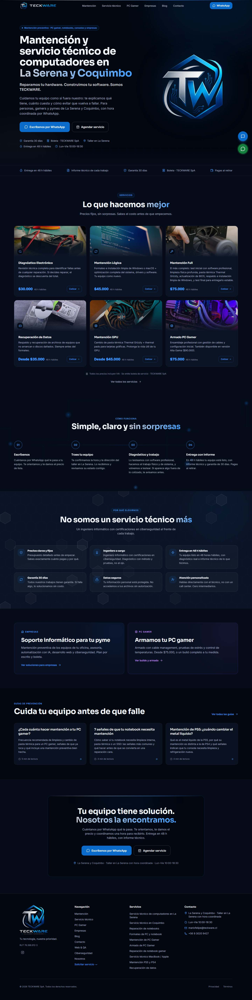 |
| Mantención |  | 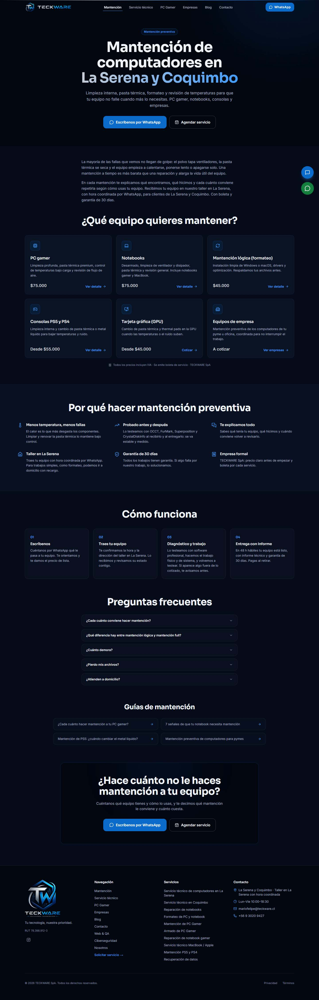 |
| Servicios |  | 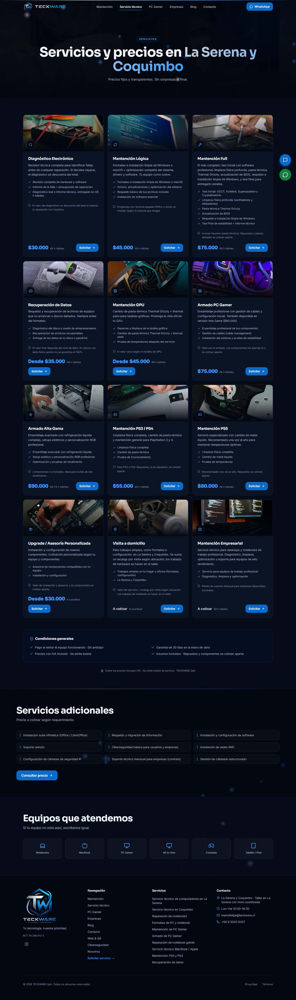 |
| Empresas |  | 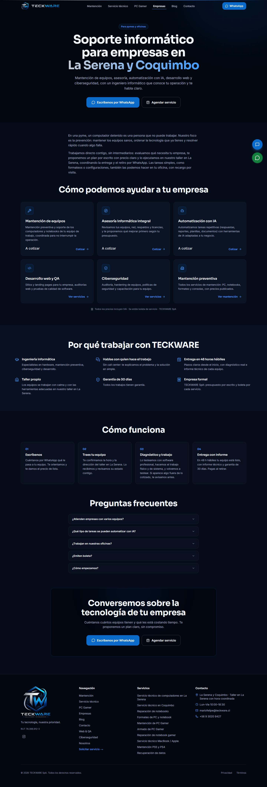 |
| PC Gamer |  | 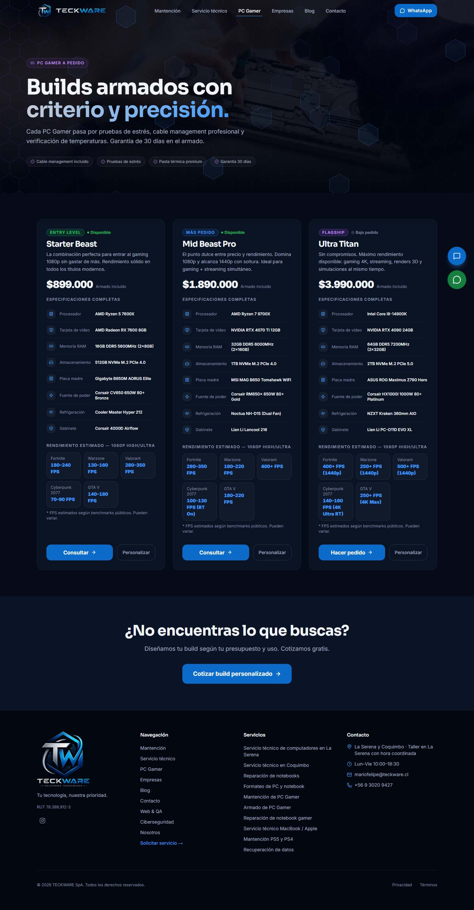 |
| Landing | 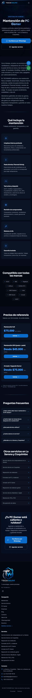 | 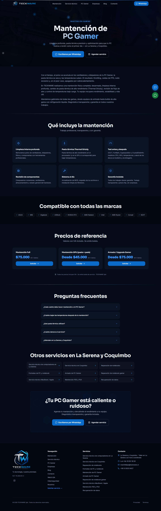 |
| Blog |  | 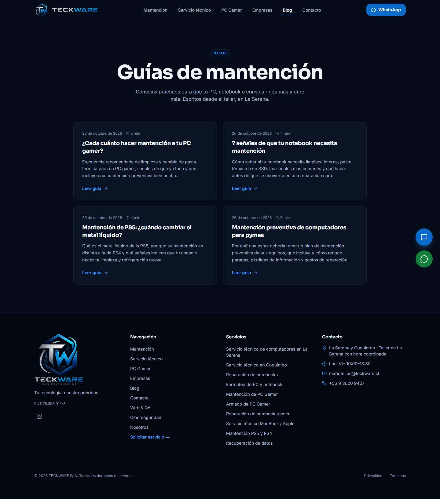 |
| Contacto |  | 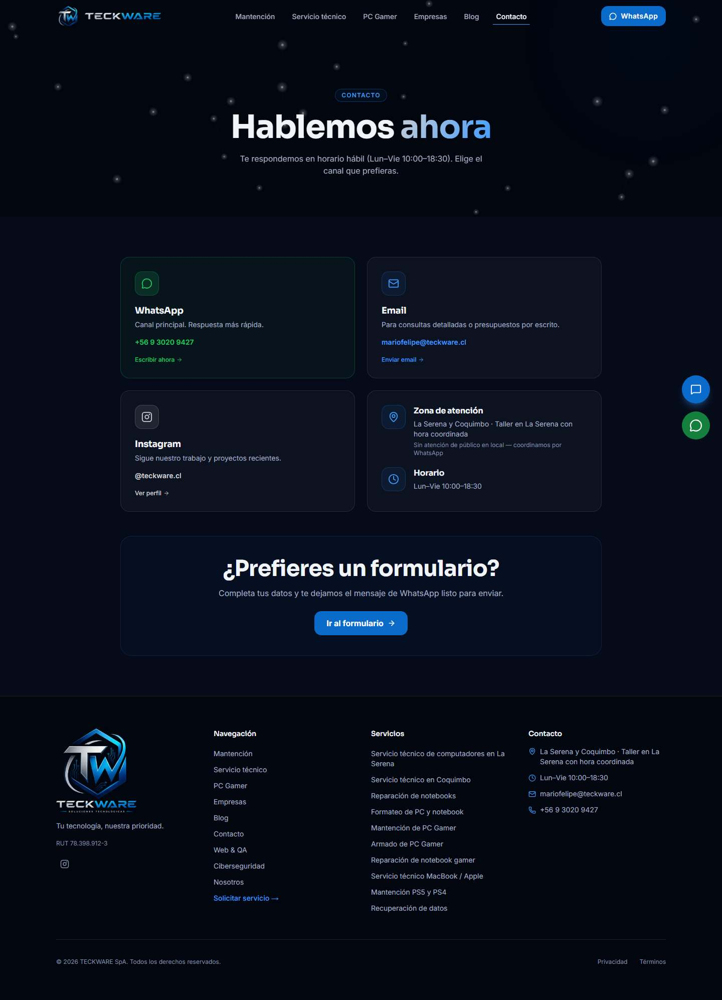 |
| Nosotros |  | 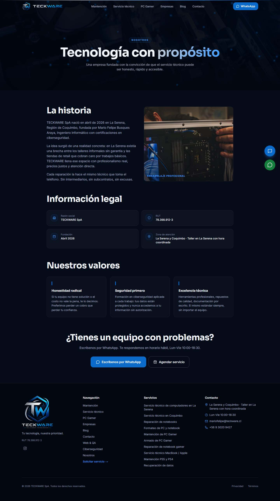 |
| Agendar |  | 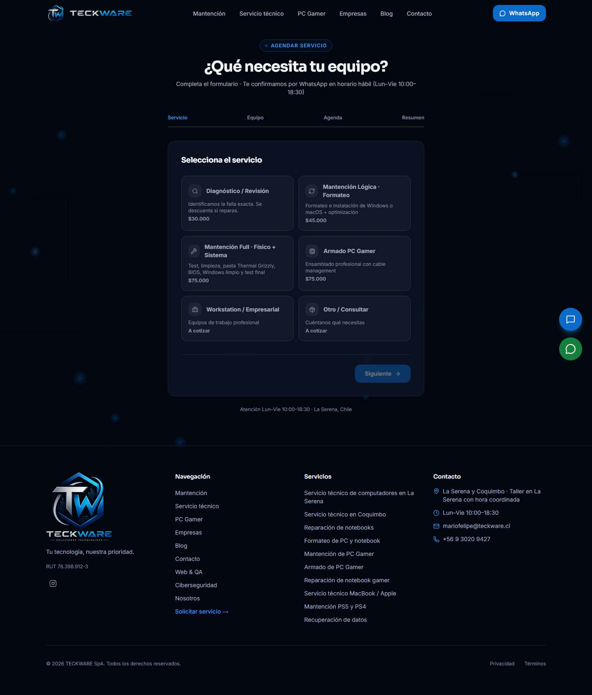 |
| Solicitar |  | 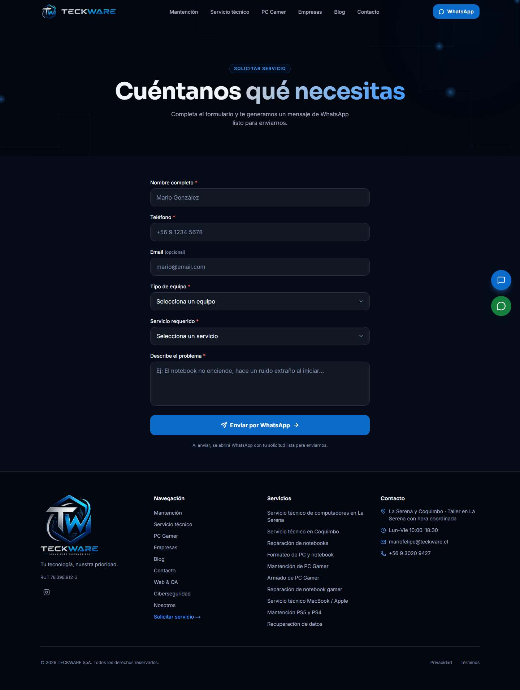 |
| 404 | 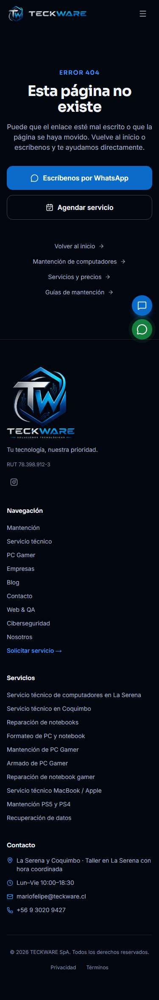 | 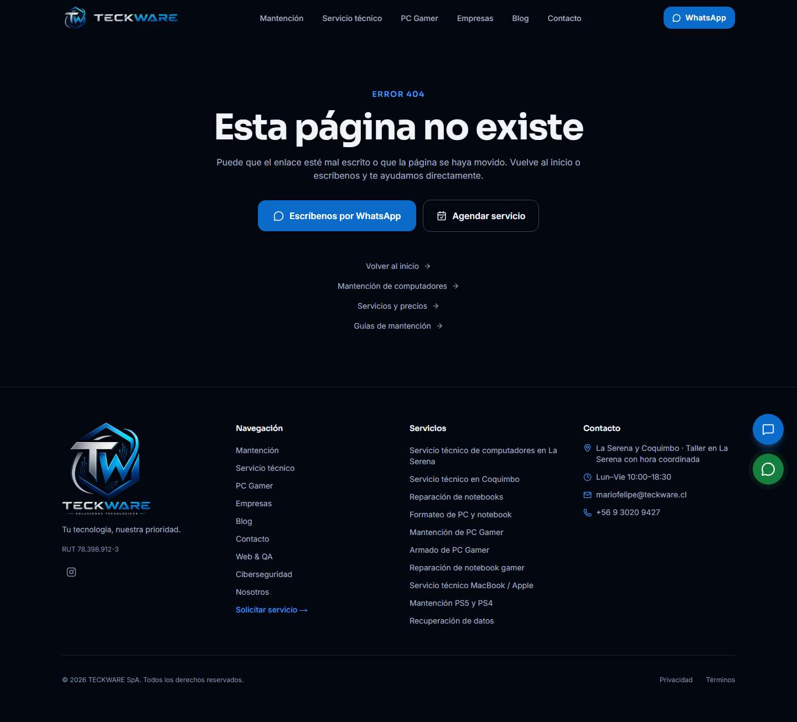 |
